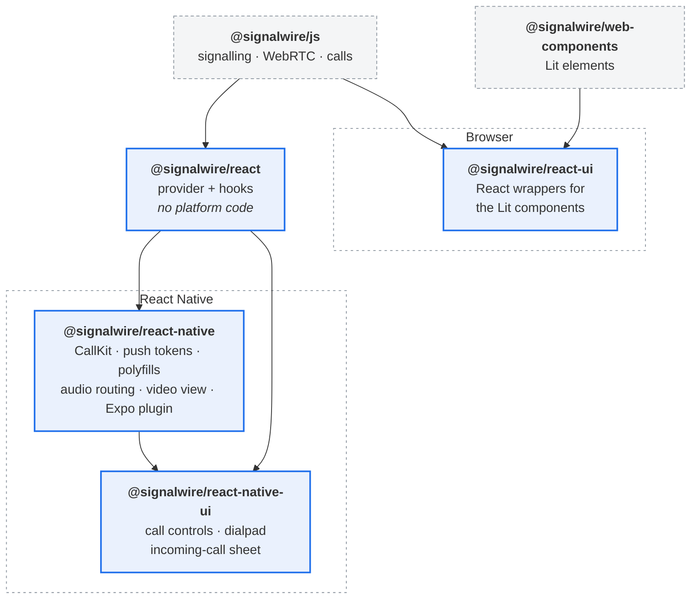
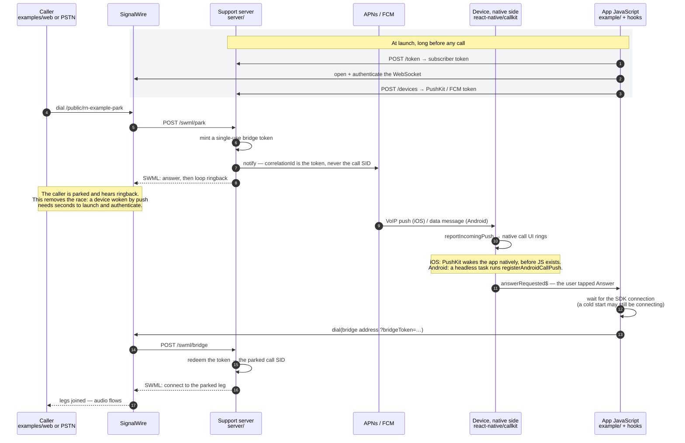

# `@signalwire/react-native`

> **Alpha.** On its way to becoming SignalWire's supported React Native SDK;
> APIs may change between alpha releases.

React Native support for [`@signalwire/js`](https://www.npmjs.com/package/@signalwire/js) v4.
Supplies the platform adapters the browser-oriented SDK needs on mobile, an
idiomatic React API over its RxJS observables, and native call UI through
CallKit and ConnectionService.

Supports iOS 13+ and Android 8+, on React Native 0.76+ (bare or Expo), with
**React Native's New Architecture only** (the default since 0.76; React
Native 0.82 removes the old one). Apps that set `newArchEnabled: false` are
not supported. The native peers (react-native-webrtc, react-native-callkeep,
react-native-incall-manager) run through React Native's interop layer for
legacy modules and views.

## What is verified

Tested on hardware and an emulator, not just in unit tests.

| | iOS | Android |
| --- | --- | --- |
| Outbound calls, with audio | ✅ iPad, iPadOS 17 | ✅ emulator, Android 16 |
| Inbound push → native call UI | ✅ PushKit + CallKit | ✅ FCM + ConnectionService |
| Answer from a **running** app | ✅ | ✅ |
| Answer from a **killed** app | ✅ | ✅ (release build — see note) |
| Two-way audio on a bridged call | ✅ | ✅ |
| Hang-up propagation, both directions | ✅ | ✅ |

These rows were verified on the old architecture. On the New Architecture the
example app has been built and launched on the iOS 27 Simulator with every
native peer; the device rows are still to be repeated on it.

Android cold start needs a **release** build to be tested meaningfully: the
Expo dev client starts a second JS runtime for the activity, so the entry
created by the headless push task is not in the context that draws the UI. One
`Android call push registered` line means one runtime; two means you are
testing the dev client, not your app.

**Known gaps**

- **Android's incoming-call UI is a notification.** With the package's Android
  module linked (rebuild the app after upgrading), a call to a backgrounded or
  killed app rings as a call notification with Answer and Decline, and opens
  the app over the lock screen through its full-screen intent; the app's own
  ringing UI takes it from there. On Android 14+ the user can revoke
  full-screen intents in Settings, and then the notification only rings.
- **A call's type is fixed when it is answered.** An outbound call's audio
  mode and CallKit type come from its own media (`call.mediaDirections`). An
  inbound call is answered audio-only, so it is a voice call. A pushed call
  starts its audio when its call connects, with that call's media. A later
  change of media during the call (adding or dropping video) re-modes
  neither the audio session nor CallKit.

## Packages

| Install this | If you are building | Contains |
| --- | --- | --- |
| [`@signalwire/react`](packages/react) | A **browser** app | Provider and hooks. No platform code. |
| [`@signalwire/react-native`](packages/react-native) | A **React Native** app | The above, re-exported, plus adapters, video view, CallKit and audio routing. |
| [`@signalwire/react-ui`](packages/react-ui) | A **browser** app wanting ready-made UI | React wrappers for the SDK's Lit components. Optional. |
| [`@signalwire/react-native-ui`](packages/react-native-ui) | An **RN** app wanting ready-made UI | Native call controls, dialpad, participants, device picker, incoming-call sheet. Optional. |

The hooks are identical on both. React Native apps install one package and get
everything; browser apps install the core and skip the native weight entirely.



Arrows point from a package to what is built on top of it. Solid boxes are
published from this repository; dashed ones are peer dependencies you install
alongside.

Two things the diagram is meant to make obvious. `@signalwire/react` holds
every hook and knows nothing about a platform — that is what lets the same
`useCall` drive a browser tab and an iPad. And `@signalwire/react-ui` does
**not** sit on `@signalwire/react`: it wraps the SDK's Lit components directly,
so the two UI packages are siblings by name only and share no code.

### Entry points

| Import | For |
| --- | --- |
| `@signalwire/react-native` | Provider, hooks, video view, `displayableName` |
| `@signalwire/react-native/polyfills` | **Must be line 1** of your entry file |
| `@signalwire/react-native/callkit` | Native call UI, push tokens, `registerAndroidCallPush` |
| `@signalwire/react-native/audio` | Speaker / earpiece / headset / Bluetooth routing |
| `@signalwire/react-native/ringing` | `useRingingPushes` and `displayableName`, for drawing your own incoming-call UI |

`./ringing` is deliberately separate from `./callkit`: the latter imports
`react-native-callkeep`, which constructs a `NativeEventEmitter` at import
time, and `./ringing` loads none of it. The main entry still imports
callkeep (see [Install](#install)), so an app needs it installed either way.

## Repository layout

| Path | What it is |
| --- | --- |
| [`packages/react/`](packages/react) | Universal core — provider and hooks |
| [`packages/react-ui/`](packages/react-ui) | React wrappers for the SDK's web components |
| [`packages/react-native/`](packages/react-native) | React Native platform layer |
| [`packages/react-native-ui/`](packages/react-native-ui) | React Native call UI components |
| [`example/`](example) | Expo dev-client demo app |
| [`examples/web/`](examples/web) | Vite browser demo — proves the core is universal |
| [`server/`](server) | Support server — device-token registry and APNs VoIP / FCM sender |
| [`docs/`](docs) | Native setup, push setup, device-test checklist |
| [`TESTING.md`](TESTING.md) | How to verify all of it, from a cold start |

## How a call flows

An **outbound** call is short, and involves no server at all once the app has a
token: `dial()` goes to SignalWire over the already-open WebSocket, and media
flows. Everything below is the **inbound** path, which is where the parts
divide up — and where every hard bug in this repository has been.



Who owns what:

| Role | Lives in | Notes |
| --- | --- | --- |
| Placing and receiving calls, media | `@signalwire/js` via `@signalwire/react` | Platform-agnostic; the hooks are the whole API |
| Native call UI, push tokens, ringing | `@signalwire/react-native/callkit` | CallKit on iOS, ConnectionService on Android |
| Waking a killed app | The OS, via PushKit / FCM | On iOS this happens **before any JavaScript exists** |
| Deciding who to ring, sending the push | `server/` — a scaffold, reimplement it | SignalWire has no push infrastructure; this is the missing middle |
| Parking the caller and bridging | `server/` SWML routes | `/swml/park` and `/swml/bridge` |
| Answering into a bridge dial | The **app**, not the package — `example/src/useBridgeAnswer.ts` | Deliberately app-level: the bridge address and token policy are yours |

Three consequences worth reading off the diagram:

- **The device dials out to answer.** It never receives an invite. The caller
  is parked and the woken device joins them, which is why an inbound call needs
  a publicly reachable server and an outbound one does not.
- **The push carries a token, not the call SID.** A payload containing the SID
  would be a capability anyone replaying it could spend. The server resolves
  the single-use token instead — which is also why answering twice fails
  cleanly.
- **Three processes must agree, and each fails silently.** The push can land
  while the app has no bundler, the funnel can be down so SignalWire never
  reaches `/swml/park`, or the SDK can still be connecting when the user hits
  Answer. All three look identical on the device: the call never arrives. See
  [`docs/device-testing.md`](docs/device-testing.md) for bringing the whole
  chain up and proving each link.

## Install

The packages are published as an alpha, under npm's `alpha` tag. Ask for it
by tag (or by exact version): a plain `npm install @signalwire/react-native`
still gets the `latest` tag, SignalWire's older 1.x SDK (signalwire-node),
until 2.0.0 is released.

```bash
npm install @signalwire/react-native@alpha @signalwire/js rxjs \
  react-native-webrtc \
  @react-native-async-storage/async-storage \
  react-native-get-random-values \
  react-native-url-polyfill \
  react-native-callkeep \
  react-native-incall-manager \
  @react-native-community/netinfo
# for the call-screen components: also @signalwire/react-native-ui@alpha
```

All of these are needed, the last three included: the main entry imports
them. `SignalWireProvider` loads the native call bridge, which imports
`react-native-callkeep` and, for audio routing, `react-native-incall-manager`;
`createReactNativePlatform()` imports `@react-native-community/netinfo` for
network-loss detection. Without one of them installed, Metro cannot bundle the
app: `Unable to resolve module react-native-callkeep` (or the other two).
They are native modules, so rebuild the app after installing them.

`@signalwire/react` comes with `@signalwire/react-native` as a dependency.
The four `@signalwire/*` packages of this repository are released together at
one version, and where one needs another it names it at that version:
`@signalwire/react-native` depends on `@signalwire/react`, and
`@signalwire/react-native-ui` takes both as peers. `@signalwire/react` and
`@signalwire/react-ui` depend on no other package of the four.

**From the repository instead** (an unreleased commit, or a fork): build the
packages and install the tarballs.

```bash
git clone https://github.com/lpradovera/signalwire-react-native-unofficial.git
cd signalwire-react-native-unofficial
npm install
npm run build
TARBALLS="$PWD/../signalwire-tarballs"   # anywhere; an absolute path
mkdir -p "$TARBALLS"
npm pack -w @signalwire/react -w @signalwire/react-native --pack-destination "$TARBALLS"
# For the call-screen components, add -w @signalwire/react-native-ui above,
# and its tarball to the install below.
```

Then, in your app (any directory; `TARBALLS` as above), install every
tarball that was packed, plus the peers above. The names carry the version,
so use a glob rather than writing it out:

```bash
npm install "$TARBALLS"/signalwire-react-[0-9]*.tgz \
  "$TARBALLS"/signalwire-react-native-[0-9]*.tgz
# with react-native-ui: also "$TARBALLS"/signalwire-react-native-ui-[0-9]*.tgz
```

Pack from one checkout at a time: a tarball left from an older version
matches the glob too. npm records a `file:` dependency for each tarball.
Copying the tarballs (or the unpacked packages) into the app, under
`vendor/` say, keeps the install reproducible on another machine and in CI.

What each native peer is for:

| Package | What uses it |
| --- | --- |
| `react-native-callkeep` | Native call UI (CallKit, ConnectionService); `@signalwire/react-native/callkit` |
| `react-native-incall-manager` | Speaker/earpiece/headset/Bluetooth routing; `@signalwire/react-native/audio` (iOS beyond speaker on/off: see [Audio routes on iOS](#audio-routes-on-ios)) |
| `@react-native-community/netinfo` | Network-loss detection and SDK reconnection |

`MissingPeerDependencyError`, which names the package and the fix, is for a
peer that is installed but not linked, such as a dev client not rebuilt since
the package was added. A peer that is not installed fails the bundle, as
above.

**This package has a little native code on iOS** (`ios/`, pod
`SignalWireReactNative`): the system audio output button,
`AudioRoutePickerButton`. It autolinks, but only into a rebuilt app: run
`pod install` (Expo: `expo prebuild` or `expo run:ios`) after installing or
upgrading. Until then the button renders nothing, and it also renders
nothing without incall-manager's iOS routes (see
[Audio routes on iOS](#audio-routes-on-ios)). Everything else, audio
routing included, is JavaScript over the peers above.

## The import-order rule

**`@signalwire/react-native/polyfills` must be the first import in your entry
file, before anything that loads `@signalwire/js`.**

```js
// index.js
import '@signalwire/react-native/polyfills';

import { registerRootComponent } from 'expo';

import App from './App';

registerRootComponent(App);
```

Four things break without it:

- The SDK bundles `uuid`, which reads `crypto.getRandomValues`. Hermes has none.
- The SDK parses dial destinations with `new URL('destination:' + address)`.
  React Native's built-in `URL` silently drops a non-HTTP scheme, so every
  `dial()` targets the wrong address.
- The SDK's entry point dispatches a `CustomEvent` on `window` at import time,
  guarded only by `typeof window !== 'undefined'`. React Native satisfies that
  guard but provides neither `CustomEvent` nor `window.dispatchEvent`, so
  importing `@signalwire/js` throws.
- The SDK calls ES2025 iterator helpers (`Iterator.prototype.map`/`.find`) on
  Map iterators. Hermes does not implement them, so touching the directory
  throws `values().map is not a function`. This one is lazy rather than
  import-time, which makes it easy to miss in a quick smoke test.

Without the import (or with it after another import that loads the SDK), the
app fails before this package's own checks can run: importing
`@signalwire/react-native` loads `@signalwire/js`, and Hermes stops with
`ReferenceError: Property 'CustomEvent' doesn't exist`. `createReactNativePlatform()`
also checks the random-values and URL polyfills and throws
`PolyfillNotInstalledError` naming the fix, but that check is reached only
when something else in the app already supplies `CustomEvent` and
`window.dispatchEvent`. Nothing checks the iterator helpers; their absence
shows only as `values().map is not a function`.

## Two build-config requirements — Expo SDK 52 only

**On Expo SDK 53 and newer, neither of these is needed.** The example app runs
on SDK 54 with a stock `babel.config.js` and no package-exports flag. They are
kept documented because the package still supports `react-native >=0.76.0`,
which includes SDK 52.

Both are consumer-side and neither is specific to Expo. You do **not** need to
change `moduleResolution` — the package ships `typesVersions`, so subpath types
resolve on Expo's stock `tsconfig.base` as well as on modern resolution.

**Metro must resolve package exports** for the `/polyfills`, `/callkit` and
`/audio` subpaths. On by default from Expo SDK 53; opt in before that:

```js
// metro.config.js
config.resolver.unstable_enablePackageExports = true;
```

**Babel must transform ES2022 static class blocks.** `@signalwire/js` ships
them in its ESM build, and `babel-preset-expo` did not handle them before
SDK 53:

```bash
npm install -D @babel/plugin-transform-class-static-block
```

```js
// babel.config.js
plugins: ['@babel/plugin-transform-class-static-block'];
```

## Quick start

New to this? [**docs/tutorial.md**](docs/tutorial.md) walks from
`create-expo-app` to a ringing phone, with a checkpoint at each stage. The
snippet below is the 30-second version.


```tsx
import {
  SignalWireProvider,
  SignalWireVideoView,
  useCall,
  useSignalWire
} from '@signalwire/react-native';
import { useMemo, useState } from 'react';
import { Button, View } from 'react-native';

import type { Call, CredentialProvider } from '@signalwire/js';

function Dialer() {
  const { isConnected, dial } = useSignalWire();
  const [call, setCall] = useState<Call | null>(null);
  const { status, hangup } = useCall(call);

  if (call) {
    return (
      <View style={{ flex: 1 }}>
        <SignalWireVideoView call={call} kind="remote" style={{ flex: 1 }} />
        <Button title={`End (${status})`} onPress={() => void hangup()} />
      </View>
    );
  }

  return (
    <Button
      title="Call"
      disabled={!isConnected}
      onPress={() => void dial('/public/my-room', { audio: true, video: true }).then(setCall)}
    />
  );
}

export default function App() {
  // Memoize: a new identity tears down the client and rebuilds it, which
  // hangs up any call in progress. To rotate a token mid-call, return
  // `expiry_at` from authenticate() and implement refresh() instead.
  const credentials = useMemo<CredentialProvider>(
    () => ({ authenticate: async () => ({ token: 'YOUR_SUBSCRIBER_TOKEN' }) }),
    []
  );

  return (
    <SignalWireProvider credentialProvider={credentials}>
      <Dialer />
    </SignalWireProvider>
  );
}
```

A pasted token expires. For a real app, pass `fetchToken` instead: the
provider fetches from your server to connect, renews ahead of expiry, on
foreground and on a call push, retries failures, and reports a 401 or 403
through `useSignalWire().tokenStatus`. See [docs/tokens.md](docs/tokens.md).

```tsx
const fetchToken = async () => {
  const body = await (await fetch(TOKEN_URL, { method: 'POST' })).json();
  return { token: body.token, expiresAt: body.expires_at };
};

<SignalWireProvider fetchToken={fetchToken}>
```

## Hooks

| Hook | Returns | Entry point |
| --- | --- | --- |
| `useSignalWire()` | `client`, `isConnected`, `isRegistered`, `user`, `directory`, `error`, `tokenStatus`, `dial`, `connect`, `disconnect` | `@signalwire/react-native` |
| `useCall(call)` | `status`, `participants`, `self`, `localStream`, `remoteStream`, `isAudioMuted`, `isVideoMuted`, `error`, `hangup`, `toggleHold`, `setAudioMuted`, `setVideoMuted`, `sendDigits` | `@signalwire/react-native` |
| `useIncomingCalls()` | `calls`, `answer`, `reject` | `@signalwire/react-native` |
| `useDevices()` | `audioInputs`, `videoInputs`, selection, `refresh` | `@signalwire/react-native` |
| `useObservable(obs$, initial)` | The latest value of any SDK observable | `@signalwire/react-native` |
| `useAudioRoute()` | `route`, `setRoute`, `setSpeakerOn` | `@signalwire/react-native/audio` |
| `useAudioDevices()` | `available`, `selected`, `selectedName` (e.g. the car's name). iOS, with incall-manager iOS routes. Live while a call's session runs; outside a call, the last status read. | `@signalwire/react-native/audio` |
| `getAudioDeviceStatus()` (function) | The same status, read now, for code outside React. Resolves `null` without iOS routes (the hook gives an empty status instead). | `@signalwire/react-native/audio` |

`useObservable` is built on `useSyncExternalStore`, so it is tear-free under
concurrent rendering, and it seeds from the SDK's synchronous getters rather
than flashing a default. Every hook is safe with a null call or client.

### Audio routes

`useAudioRoute()` has four routes, one for each of incall-manager's devices:
`'earpiece'` (the receiver), `'speaker'`, `'headset'` (a wired or USB-C
headset) and `'bluetooth'` (a Bluetooth headset or a car). Use `setSpeakerOn(on)` for a speaker toggle: off returns to the
route the call had before (a connected headset or car, or the receiver).
`setRoute(route)` is a choice of that route; `setRoute('earpiece')` means the
phone's receiver, as on Android, and with iOS routes it moves a call off a
connected headset or car. A toggle written as
`setRoute(route === 'speaker' ? 'earpiece' : 'speaker')` should use
`setSpeakerOn(route !== 'speaker')`.

A route chosen before the call's audio session starts (a speaker tap while an
outbound CallKit call still rings) shows at once and is applied when the
session starts; if the call ends first, it is dropped. The CallKit bridge
starts and stops the session for the calls it tracks. Without CallKit (or
for a call it doesn't track), call `getAudioRouteController().start(media)`
when the call connects and `stop()` when it ends; with no session only the
speaker setting can be written, and only on iOS (speaker on and off;
`'headset'` and `'bluetooth'` are ignored with a warning), because on
Android incall-manager refuses every route before its `start()`. A video call starts on the speaker only when nothing else is
connected: incall-manager's own start decides, and this package doesn't force
the speaker over a headset or car. `route` shows the media's default (`'speaker'`
for video) until the session's first status replaces it: on Android
incall-manager reports its devices, and with iOS routes the session reads
them; a choice made before that status is held and then applied to the
reported route. A route that can't be chosen (no such device) goes back to
where it was, on Android too.

#### Audio routes on iOS

This package never writes the iOS audio session itself: incall-manager does,
and so do callkeep (its category and mode on every CallKit activation) and
WebRTC. Released incall-manager (through 4.3.0) has iOS speaker on/off only,
and what you get depends on which you have:

| | incall-manager 4.3.0 | incall-manager with iOS routes |
| --- | --- | --- |
| Speaker on / off | ✅ | ✅ |
| `setRoute('earpiece')` | Speaker off; a connected headset or car keeps the call | The receiver |
| `setRoute('headset')` | Speaker off; a plugged-in headset takes the call | The wired or USB-C headset |
| `setRoute('bluetooth')` | Ignored, with one warning | A connected Bluetooth headset or car |
| `route` | What was asked for; at start the media's default (`'speaker'` for video), even when iOS kept the call on a headset or car | What iOS reports: the starting device, a headset or car connecting or dropping, a choice in the system route menu or CallKit |
| `useAudioDevices()` | Empty | The devices, by name, kept current during a call |

iOS routes come from a change to incall-manager that is proposed upstream
(chooseAudioRoute, getAudioDeviceStatus and onAudioDeviceChanged on iOS, with
incall-manager following route changes it didn't make). To use it now, apply
[`docs/patches/react-native-incall-manager+4.3.0.patch`](docs/patches/react-native-incall-manager+4.3.0.patch)
with [patch-package](https://github.com/ds300/patch-package): pin
`react-native-incall-manager` to `4.3.0`, install patch-package
(`npm install --save-dev patch-package`), copy the file into your app's
`patches/`, add `"postinstall": "patch-package"` to its scripts, run
`npm install` (which applies it), and rebuild the app (native code). A vendored copy of incall-manager with the same change works the same
way. This package detects the iOS routes at run time, so nothing else
changes; without them it falls back as in the first column.

For iOS's own output menu, render `<AudioRoutePickerButton />` from
`@signalwire/react-native/audio` (an `AVRoutePickerView`, which lists the phone,
the speaker and each connected headset or car by name, and switches the call
itself). `CallControls` in `@signalwire/react-native-ui` shows it on iOS next
to the speaker toggle; `showRoutePicker` defaults to `showAudioRoute`. The
button needs incall-manager's iOS routes, which follow a choice made there
(`route` reports it) and keep it. **On released incall-manager 4.3.0 the
button isn't rendered** (`isAudioRoutePickerAvailable()` is false): nothing
would report its choice, and 4.3.0 re-applies the speaker on the next audio
category change, undoing it. There `CallControls` offers speaker on/off
only; for full routing, apply the incall-manager patch above
(`docs/patches/`) or wait for the upstream change. VoiceOver reads the button as
a button, "Audio output" (`accessibilityRole`, `accessibilityLabel`). Its
`style` (background, border, radius, padding) is drawn once, on the view around
the native picker, the padding insets the icon, and a tap anywhere in that view
opens the menu. Its `activeTintColor` is AVKit's
colour for AirPlay being active; a headset or car is not AirPlay.

`useDevices()` has no `refresh`-free auto-update: React Native emits no
`devicechange` event, so the platform sets `skipDeviceMonitoring: true` and you
call `refresh()` yourself — typically on app foreground or when opening a picker.

## Native call UI

```ts
// index.js — before React mounts, so a cold-start VoIP push finds it ready
import { getCallKit } from '@signalwire/react-native/callkit';

void getCallKit().setup({ appName: 'My App', supportsVideo: true });
```

`supportsVideo` lets the native UI offer video; it does not make a call a
video call. An outbound call is a video call when its own media
(`call.mediaDirections`) sends or receives video, and starts on the speaker;
every other call, including every inbound call (always answered audio-only),
is a voice call on the earpiece.

```tsx
<SignalWireProvider credentialProvider={credentials} callKit>
```

The native call UI and Recents show an outbound call by a readable form of its
destination: a Fabric address's last segment, humanised (`/private/support-agent`
shows as `Support Agent`), a SIP URI's user part, or a number as it is. To show
a name of your own, pass options in place of `true`:

```tsx
<SignalWireProvider credentialProvider={credentials} callKit={{ displayName: (to) => contacts[to] ?? to }}>
```

The observer is built when `callKit` turns on and dropped when it turns off,
which also stops CallKit from showing the client's inbound calls; changing
only the options doesn't rebuild it. Each call reads the latest
`displayName`, so it can close over data that loads later. A Fabric address
it returns is made readable the same way. If it throws or returns an empty
string, the call is named by its destination: the call has already been placed
by then, so it is still tracked. An inbound call's `fromName` that is a Fabric
address is shown readably too, and the placeholder `_undef_` some calls carry
for a missing name shows as "Unknown caller" (with a debug log line).

Native call UI runs **one call at a time**. While a call is live (a ringing
push included), `dial()` rejects with `CallInProgressError` before anything
is placed: CallKit would refuse the second call's start, and callkeep does not
tell JavaScript, so the call would run with no native UI to end it from.
Answering a push by dialling a bridge is not refused.

```ts
import { CallInProgressError } from '@signalwire/react-native';

try {
  setCall(await dial(destination));
} catch (error) {
  if (error instanceof CallInProgressError) {
    showToast('Hang up the current call first');
  } else {
    throw error;
  }
}
```

Calls appear in the Phone app's Recents. To call back from there, or from
Siri, dial what `getCallKit().startCallRequested$` emits (`handle`,
`displayName`, `video`); the Expo plugin generates the native forwarder it
needs. See [native setup](docs/native-setup.md#ios-calling-back-from-recents-and-siri).

Then, from your own push handler:

```ts
getCallKit().reportIncomingPush({ callId, from, fromName });
```

**The push payload must carry the SignalWire call id.** `CallRegistry` fuses the
native call entry with the SDK call by matching on it. Without it, the registry
falls back to "the single unmatched inbound call within the timeout" and logs a
warning — which breaks as soon as two calls overlap.

This package does not acquire push tokens, and **SignalWire has no push
infrastructure** — it will not send the push for you. The whole chain is yours:
your backend learns an inbound call is coming (webhook), looks up the device
token, and sends the push; the app receives it and calls `reportIncomingPush`.
That call is the entire contract with this package.

**The bridge consumes callkeep's launch buffer.** callkeep holds the events
that fired before JavaScript started and sends them to `didLoadWithEvents`
listeners; the bridge replays the call events among them and then calls
`RNCallKeep.clearInitialEvents()`, because callkeep would otherwise send the
same buffer again after an in-process JS reload. After that,
`RNCallKeep.getInitialEvents()` resolves `[]`. To see the launch events
yourself (a buffered mute, say), register your own `didLoadWithEvents`
listener in your entry file: it receives the same dispatch. A Recents or Siri
call-back that launched the app is among them (the plugin's
`continueUserActivity` forwarder hands it to callkeep), and the bridge also
delivers it through `startCallRequested$`.

A runnable support server lives in [`server/`](server/) — device-token registry,
APNs VoIP and FCM senders, and a webhook endpoint.
**[`docs/push-setup.md`](docs/push-setup.md) is the full end-to-end guide** —
Apple/Firebase setup, the `AppDelegate` hook, backend senders for APNs VoIP and
FCM, and a link-by-link verification ladder.
[`docs/native-setup.md`](docs/native-setup.md) covers vendor choice.

## Not supported, and why

| Feature | Reason |
| --- | --- |
| Screen sharing | `getDisplayMedia` does not exist on React Native. The provider omits it so the SDK correctly reports screen share as unsupported. |
| Audio level meters, noise suppression | The SDK implements these with `AudioContext`, which React Native has no equivalent for. |
| Audio output selection via `setSinkId` | No `HTMLMediaElement`. Use `useAudioRoute()` instead. |
| DPoP / client-bound SAT refresh | Needs WebCrypto RSA plus IndexedDB. The SDK degrades gracefully; supply `refresh()` on your `CredentialProvider`. |

## Troubleshooting

**`ReferenceError: Property 'CustomEvent' doesn't exist`** at startup, or
**`PolyfillNotInstalledError`** — `@signalwire/react-native/polyfills` is missing
or not first in your entry file. See the import-order rule above.

**`Unable to resolve module @signalwire/react-native/polyfills`** — Metro package
exports are off. Set `resolver.unstable_enablePackageExports = true`. Expo SDK 52
only; on by default from SDK 53.

**`Static class blocks are not enabled`** — add
`@babel/plugin-transform-class-static-block` to `babel.config.js`.

**`MissingPeerDependencyError`** — the named package is absent, or installed but
not natively linked. Install it and rebuild the native app (`npx expo prebuild
--clean`, or a fresh pod install / gradle build).

**Call connects on iOS but is silent** — audio started before CallKit activated
the audio session. The bridge gates on `didActivateAudioSession`; if you start
media yourself, wait for that event too.

**Network loss is not detected** — check for `Network monitoring unavailable,
continuing with reduced resilience` in the log: the NetInfo shim could not
start, and the line carries the reason. Also check the app did not pass
`platform={{ netInfo: false }}` to the provider (or `netInfo: false` to
`createReactNativePlatform()`). (`@react-native-community/netinfo`
itself must be installed, or the app does not bundle; see [Install](#install).)

## Development

```bash
npm install
npm test                # 192 unit tests, ~95% statement coverage
npm run type-check
npm run lint
npm run build
npm run bundle-check     # Metro bundles the example for iOS and Android
npm run verify           # all of the above, in order
npm run verify:package   # publint + are-the-types-wrong on all four packages
npm run verify:prebuild  # real `expo prebuild`, asserts the config plugin applied
```

Native behaviour cannot be verified without a device. To pick this up on a
fresh machine, start with [`TESTING.md`](TESTING.md) — it covers environment
bootstrap, the expected output of every check, a known Android build blocker,
and failure triage. [`docs/device-testing.md`](docs/device-testing.md) is the
12-scenario hardware checklist it ends at.
